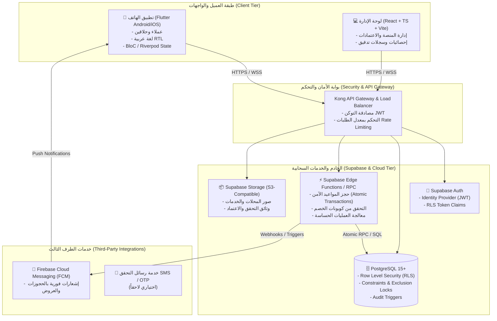

# وثيقة المعمارية التقنية والهندسة البرمجية | منصة وسيم (WASEEM)
> **إصدار الوثيقة:** 1.0  
> **التاريخ:** 2026-10-10  
> **الحالة:** معتمد للمرحلة 1  

---

## 1. المعمارية العامة للنظام (High-Level System Architecture)

تعتمد منصة "وسيم" على معمارية سحابية حديثة قائمة على مبدأ **BaaS (Backend-as-a-Service) + Edge Compute** مع تطبيق هاتف ذكي هجين فائق الأداء مبني بإطار عمل **Flutter**، ولوحة إدارة متقدمة مبنية بـ **React & TypeScript**.



---

## 2. هيكل المستودع الموحد المقترح (Monorepo Folder Structure)

نعتمد هيكلية مستودع موحد (Monorepo) تجمع كل مكونات النظام بتنسيق مرتب وسهل التطوير والصيانة:

```
waseem/
├── assets/                          # الأصول المشتركة والتصميم
│   └── brand/
│       └── waseem_logo.png          # الشعار الرسمي الأصلي لمنصة وسيم
├── docs/                            # التوثيق والمواصفات المعمارية
│   ├── reference/
│   │   └── ui_reference.jpg         # صورة مرجع تدفق الشاشات (FreshCut)
│   ├── REQUIREMENTS.md              # وثيقة المتطلبات الوظيفية وغير الوظيفية
│   ├── ARCHITECTURE.md              # هذه الوثيقة: المعمارية والمكتبات
│   ├── DATABASE.md                  # توثيق مخطط قاعدة البيانات والعلاقات
│   └── TESTING.md                   # استراتيجية ونتائج الاختبارات
├── mobile/                          # تطبيق وسيم للهاتف المحمول (Flutter)
│   ├── android/                     # إعدادات منصة أندرويد
│   ├── assets/                      # أصول التطبيق (أيقونات، خطوط عربية، صور)
│   ├── lib/                         # كود التطبيق المصدري (Clean Architecture)
│   │   ├── core/                    # المكونات الأساسية المشتركة
│   │   │   ├── constants/           # الثوابت والألوان والأبعاد
│   │   │   ├── errors/              # الفشل ومعالجة الاستثناءات
│   │   │   ├── network/             # عميل الاتصال والمصادقة
│   │   │   ├── theme/               # ثيم وسيم الأخضر والذهبي
│   │   │   └── utils/               # أدوات مساعدة وتنسيق التواريخ
│   │   ├── features/                # الوحدات الوظيفية المقسمة حسب الميزات
│   │   │   ├── auth/                # المصادقة وإدارة الحساب
│   │   │   ├── barber/              # واجهات ووظائف الحلاق وإدارة الصالون
│   │   │   ├── booking/             # مسار الحجز واختيار المواعيد وتأكيدها
│   │   │   ├── home/                # الرئيسية واستكشاف الصالونات
│   │   │   ├── offers/              # العروض والخصومات
│   │   │   └── profile/             # الملف الشخصي والإعدادات
│   │   ├── l10n/                    # ملفات التعريب والترجمة (arb files)
│   │   └── main.dart                # نقطة الدخول الرئيسية للتطبيق
│   ├── pubspec.yaml                 # حزم واعتمادات فلاتر
│   └── .env.example                 # نموذج المتغيرات البيئية للموبايل
├── admin/                           # لوحة الإدارة المركزية (React + TS + Vite)
│   ├── src/
│   │   ├── components/              # مكونات الواجهة الموحدة بهوية وسيم
│   │   ├── pages/                   # صفحات الإدارة (الحلاقين، العملاء، التقارير)
│   │   ├── services/                # خدمات استدعاء Supabase
│   │   └── types/                   # تعريفات TypeScript
│   ├── package.json
│   └── .env.example
├── supabase/                        # خادم وقاعدة بيانات Supabase
│   ├── migrations/                  # ملفات ترحيل SQL المهيكلة زمنياً
│   ├── seed.sql                     # بيانات تجريبية للتطوير الأولي
│   ├── functions/                   # دوال الحافة (Edge Functions / Deno)
│   └── config.toml
├── .gitignore                       # تجاهل المفاتيح والملفات المولدة
└── README.md                        # دليل المشروع الشامل باللغة العربية
```

---

## 3. حزم ومكتبات Flutter المقترحة وأسباب الاختيار

| الحزمة / المكتبة | الغرض التقني | سبب الاختيار المعتمد |
| :--- | :--- | :--- |
| **`flutter_bloc` / `bloc`** | **إدارة الحالة (State Management)** | - أداء قياسي ومعياري يضمن فصل منطق العمل تماماً عن الواجهات.<br>- سهولة كتابة Unit Tests وMocking للأحداث وحالات الشاشة.<br>- بنية منظمة وموثوقة للمشاريع الإنتاجية الكبرى. |
| **`go_router`** | **التوجيه والتنقل (Routing)** | - التوجيه الرسمي المدعوم من فريق Flutter.<br>- دعم التنقل العميق (Deep Linking) والتوجيه بحسب صلاحية المستخدم (Redirection Guards بناءً على Auth State).<br>- دعم التنقل المتشعب لشريط التنقل السفلي (StatefulShellRoute). |
| **`flutter_localizations` + `intl`** | **التعريب وتعدد اللغات (i18n & l10n)** | - الحل الرسمي القياسي من فلاتر باستخدام ملفات `.arb`.<br>- دعم كامل ومباشر للغة العربية (RTL) والأرقام وصيغ الجموع (Pluralization) دون حزم خارجية إضافية تثقل التطبيق. |
| **`supabase_flutter`** | **التكامل مع Supabase** | - مكتبة SDK الرسمية لدعم المصادقة (Auth)، واستعلامات قاعدة البيانات، والبث اللحظي (Realtime Channels)، والتخزين السحابي. |
| **`flutter_secure_storage`** | **التخزين الآمن المحلي** | - حفظ رموز التوثيق والجلسات المشفرة محلياً باستخدام KeyStore على أندرويد وKeychain على iOS. |
| **`cached_network_image`** | **الصور والتخزين المؤقت** | - تحسين أداء تحميل صور الصالونات، وتقليل استهلاك باقة الإنترنت للعميل، وتوفير تجربة بصرية سلسة أثناء التمرير مع Shimmer Loading. |
| **`google_fonts`** | **الخطوط العربية الراقية** | - تضمين خط عربي أصيل وأنيق ومريح للقراءة (مثل: *Cairo* أو *Tajawal*) لتعزيز هوية تطبيق وسيم. |
| **`firebase_core` + `firebase_messaging`** | **الإشعارات السحابية** | - التكامل الموثوق لإشعارات الدفع (Push Notifications) على نظام أندرويد في الخلفية والواجهة. |

---

## 4. القرارات المعمارية للنقاط غير المحسومة وتوصياتها

### النقطة 1: نموذج العمولة / الاشتراك (Business Model)
- **الخيارات المطروحة:**
  1. *نموذج العمولة لكل حجز منجز (Commission per completed booking):* مثلاً اقتطاع نسبة مئوية (5% - 10%) أو مبلغ ثابت لكل حجز مكتمل.
  2. *نموذج الاشتراك الشهري الثابت (Flat Monthly Subscription):* دفع رسوم شهرية ثابتة للصالون مقابل إدراجه في المنصة دون عمولة على الحجوزات.
  3. *النموذج الهجين (Freemium + Subscription):* فترة مجانية لعدد محدد من الحجوزات، ثم باقة اشتراك شهري مع ميزات إضافية (أولوية الظهور والإحصاءات).
- **التوصية والافتراض المعتمد:**
  > **الاعتماد في المرحلة الأولى:** تفعيل **نموذج مجاني / تجريبي مبدئي** للحلاقين في قاعدة البيانات مع دعم حقل مرن `commission_rate` و `subscription_status` على مستوى جدول المحلات (`barber_shops`). هذا يتيح للمنصة النمو السريع وجذب الحلاقين دون عوائق، مع الجاهزية البرمجية التامة لتطبيق أي من النموذجين فورياً عبر لوحة الإدارة.

---

### النقطة 2: سياسة الإلغاء (Cancellation Policy)
- **الخيارات المطروحة:**
  1. *إلغاء مرن (Flexible):* متاح للعميل حتى ساعة واحدة قبل الموعد دون قيود.
  2. *إلغاء معتدل (Moderate - موصى به):* متاح مجاناً للعميل حتى ساعتين أو 3 ساعات قبل الموعد. الإلغاء المتأخر يسجل في سجل العميل (تنبيه عند تكرار التخلف عن الحضور "No-Show").
  3. *إلغاء صارم (Strict):* لا يمكن الإلغاء قبل أقل من 6 ساعات، مع تعليق الحساب عند تكرار الإلغاء مرتين متتاليتين.
- **التوصية والافتراض المعتمد:**
  > **الاعتماد:** **السياسة المعتدلة (Moderate)**:
  > - السماح للعميل بإلغاء الحجز بحرية حتى ساعتين قبل بدء الموعد المحدد.
  > - في حال الإلغاء قبل أقل من ساعتين، يتم تغيير الحالة إلى `late_cancellation`، وإذا تجاوز العميل 3 حالات عدم حضور أو إلغاء متأخر خلال شهر، يتطلب حجزه القادم موافقة مباشرة أو تأكيداً مسبقاً.
  > - يتم تخزين المهلة الزمنية كمتغير في قاعدة البيانات (`cancellation_window_hours = 2`) لسهولة التعديل.

---

### النقطة 3: طريقة تأكيد الحجز (Booking Confirmation Mode)
- **الخيارات المطروحة:**
  1. *تأكيد فوري تلقائي (Instant Automatic Confirmation - موصى به):* بمجرد اختيار الوقت المتاح الشاغر، يُحجز الموعد ويؤكد فورياً على قاعدة البيانات دون انتظار موافقة يدوية من الحلاق.
  2. *طلب حجز معلق بموافقة الحلاق (Manual Request Approval):* يدخل الحجز في حالة معلقة (`pending_approval`) ويمنح الحلاق مهلة زمنية (مثلاً 15 دقيقة) للموافقة أو الرفض.
  3. *خيار مرن يحدده الحلاق في إعدادات صالونه.*
- **التوصية والافتراض المعتمد:**
  > **الاعتماد:** **التأكيد الفوري التلقائي (Instant Booking)** مع دعم إعداد تحكم للصالون:
  > - المنصة مبنية على دقة فترات التوفر وساعات العمل، وبالتالي فالحجز الفوري التلقائي يضمن أعلى معدل تحويل وأفضل تجربة للمستخدم، ويمنع ضياع المواعيد.
  > - يتلقى الحلاق إشعاراً فورياً بالموعد الجديد ويظهر مباشرة في جدوله اليومي، مع إمكانية إضافة مفتاح في إعدادات الصالون (`auto_confirm: true/false`) لمن يفضل الموافقة اليدوية.

---

## 5. خطة تنفيذ المراحل (2 إلى 15) ومعايير الاكتمال (Definition of Done)

| المرحلة | اسم ومضمون المرحلة | معيار الاكتمال الصارم (Definition of Done) |
| :---: | :--- | :--- |
| **المرحلة 2** | هيكل المشروع وتهيئة Flutter | - إنشاء بنية المجلدات المعتمدة كاملة.<br>- مشروع Flutter مهيأ داخل `mobile/` بنجاح.<br>- دعم العربية وRTL يعمل افتراضياً.<br>- بناء المشروع وتشغيل `flutter analyze` دون أخطاء حرجة. |
| **المرحلة 3** | الهوية والشاشات الأساسية | - نظام التصميم والألوان (`#123D32` و `#F0D49A`) والخطوط العربية مطبق.<br>- الشعار الأصلي مدمج في شاشات البداية والدخول.<br>- الشاشات الأساسية الخمس (Splash, Welcome, Login, Register, Home Shell) مبنية ببيانات تجريبية واضحة. |
| **المرحلة 4** | مخطط قاعدة البيانات | - ملفات SQL المهاجرة كاملة في `supabase/migrations/` وتغطي كل الجداول.<br>- قيد أو دالة منع التعارض في المواعيد مصممة وموثقة.<br>- ملف `docs/DATABASE.md` وملف seed جاهزان. |
| **المرحلة 5** | المصادقة والصلاحيات وRLS | - ربط تطبيق الهاتف بـ Supabase Auth لجميع الحالات.<br>- تفعيل RLS على كل الجداول وفرض الأدوار خادمياً.<br>- تنفيذ واختبار سياسات الصلاحيات وعدم وصول أي مستخدم لبيانات غيره. |
| **المرحلة 6** | واجهة العميل | - ربط الشاشات بالبيانات الحقيقية: الرئيسية، البحث والتصفية، صفحة الصالون، المفضلة، والملف الشخصي.<br>- معالجة حالات الفراغ والتحميل والخطأ وضعف الاتصال. |
| **المرحلة 7** | واجهة الحلاق | - إدارة الملف المهني ورفع الصور مع التحقق خادمياً.<br>- إدارة الخدمات والأسعار ومددها وتحديث التوفر.<br>- تطبيق حالة اعتماد الحساب (`pending_review` / `approved`). |
| **المرحلة 8** | المواعيد والحجز ومنع التعارض | - حساب التوفر الحقيقي خادمياً ومعالجة أوقات العمل والراحة.<br>- إنشاء الحجز عبر دالة ذرية (RPC / Edge Function) داخل Transaction.<br>- اختبار التزامن ورفض الطلب الثاني على الموعد نفسه بنجاح. |
| **المرحلة 9** | العروض والخصومات | - إدارة العروض للحلاق وتطبيقها للعملاء.<br>- التحقق من صحة الخصم وحساب السعر نهائياً على الخادم.<br>- إثبات حصانة النظام ضد أي تلاعب بالأسعار من طرف العميل. |
| **المرحلة 10** | لوحة الإدارة (React + TS) | - تطبيق لوحة التحكم داخل `admin/` بهوية وسيم.<br>- اعتماد طلبات الحلاقين، إدارة المستخدمين والمناطق والبلاغات وسجل التدقيق.<br>- فرض الصلاحيات عبر RLS وليس فقط إخفاء أزرار الواجهة. |
| **المرحلة 11** | الإشعارات السحابية (FCM) | - إعداد وتكامل FCM وإرسال الإشعارات عبر الخادم للأحداث الرئيسية (تأكيد، إلغاء، تذكير).<br>- الالتزام بعدم عرض بيانات حساسة في شاشة القفل. |
| **المرحلة 12** | الإحصاءات والتقارير | - لوحات الإحصاء للحلاق والمدير مع فصل الإيرادات المسجلة عن المحصلة نقدياً.<br>- تحديث حالة الدفع النقدي من قبل الحلاق. |
| **المرحلة 13** | الاختبارات الوظيفية والأمنية | - تنفيذ الاختبارات الوظيفية والأمنية الشاملة وتوثيقها في `docs/TESTING.md`.<br>- فحص تسريب المفاتيح، سياسات RLS، وحدود الطلبات. |
| **المرحلة 14** | بناء APK للاختبار | - بناء ملف APK تجريبي بصيغة صحيحة والتأكد من إمكانية تثبيته.<br>- توثيق خطوات التثبيت والتشغيل بالتفصيل في `README.md`. |
| **المرحلة 15** | نسخة الإصدار والنشر | - تجهيز إعدادات الإنتاج، توقيع التطبيق، سياسة الخصوصية والشروط، وآلية حذف الحساب.<br>- التحقق من النسخ الاحتياطي وقائمة الجاهزية للنشر. |
