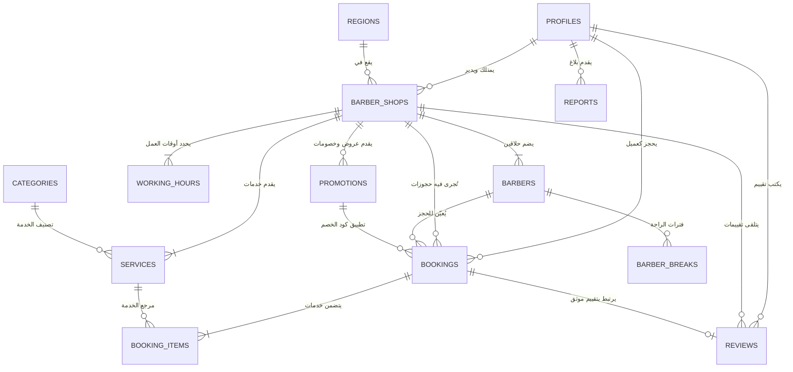

# توثيق مخطط قاعدة البيانات والعلاقات | منصة وسيم (WASEEM)
> **تاريخ الإنشاء:** 2026-10-10  
> **حالة المخطط:** معتمد للمرحلة 4 (الجداول، العلاقات، الفهارس، وقيد منع التعارض)

---

## 1. مخطط الكيانات والعلاقات (ER Diagram)



---

## 2. تفاصيل الجداول والمفاتيح الأساسية والخارجية

### 2.1 `profiles` (ملفات المستخدمين)
- **المفتاح الأساسي:** `id` (UUID مطابق لـ `auth.users(id)`).
- **الحقول:** `role` (enum: client, barber, admin), `full_name`, `phone_number`, `avatar_url`, `created_at`, `updated_at`.
- **الفهارس:** `idx_profiles_role`, `idx_profiles_phone`.

### 2.2 `barber_shops` (صالونات الحلاقة)
- **المفتاح الأساسي:** `id` (UUID).
- **المفاتيح الخارجية:** `owner_id -> profiles(id)`, `region_id -> regions(id)`.
- **الحقول:** `name`, `description`, `address_text`, `latitude`, `longitude`, `status` (pending_review, approved, suspended, rejected), `auto_confirm`, `cancellation_window_hours`, `commission_rate`, `rating_average`, `rating_count`.
- **الفهارس:** `idx_barber_shops_status`, `idx_barber_shops_owner`, `idx_barber_shops_region`.

### 2.3 `barbers` (الحلاقين العاملين)
- **المفتاح الأساسي:** `id` (UUID).
- **المفاتيح الخارجية:** `shop_id -> barber_shops(id)`, `profile_id -> profiles(id)`.
- **الحقول:** `name`, `title`, `photo_url`, `is_active`.

### 2.4 `services` (الخدمات والأسعار)
- **المفتاح الأساسي:** `id` (UUID).
- **المفاتيح الخارجية:** `shop_id -> barber_shops(id)`, `category_id -> categories(id)`.
- **الحقول:** `name_ar`, `description`, `duration_minutes` (>0), `price` (>=0), `is_active`.

### 2.5 `working_hours` & `barber_breaks` (ساعات العمل والراحة)
- **`working_hours`:** ساعات الصالون حسب أيام الأسبوع (0-6) مع قيد `UNIQUE(shop_id, day_of_week)`.
- **`barber_breaks`:** أوقات راحة الحلاق اليومية أو الاستثنائية.

### 2.6 `bookings` & `booking_items` (الحجوزات وعناصرها)
- **`bookings`:**
  - **المفتاح الأساسي:** `id` (UUID)، ومفتاح مرجعي فريد `booking_reference` (مثال: `WAS-XXXXXXXX`).
  - **المفاتيح الخارجية:** `client_id`, `shop_id`, `barber_id`, `promotion_id`.
  - **الحقول الزمنية:** `start_time`, `end_time` مع حقل النطاق الزمني المحسوب `booking_period TSTZRANGE`.
  - **المبالغ:** `subtotal_price`, `discount_amount`, `final_price` (محسوبة خادمياً).
  - **الحالة:** `status` (confirmed, in_progress, completed, cancelled_by_client, cancelled_by_barber, no_show), `payment_status`.
- **`booking_items`:** حفظ لقطة تاريخية (Snapshot) لكل خدمة محجوزة (الاسم، السعر الأصلي، المدة).

### 2.7 `promotions` (عروض وسيم)
- **المفتاح الأساسي:** `id` (UUID).
- **المفتاح الخارجي:** `shop_id -> barber_shops(id)`.
- **الحقول:** `code`, `title`, `discount_type` (percentage, fixed_amount), `discount_value`, `start_date`, `end_date`, `max_uses`, `used_count`.

### 2.8 `reviews`, `reports`, `audit_logs`
- **`reviews`:** تقييم من 1 إلى 5 مع تعليق، مرتبط بحجز مكتمل واحد فقط `booking_id UNIQUE`.
- **`reports`:** بلاغات العملاء والحلاقين للبت الإداري.
- **`audit_logs`:** سجل تدقيق العمليات الإدارية الحساسة.

---

## 3. آلية منع تضارب الحجوزات (Concurrency & Double-Booking Prevention)

تم تصميم حماية مزدوجة لمنع حجز نفس الحلاق مرتين في الموعد نفسه إطلاقاً:
1. **قيد الحرمان في PostgreSQL (Exclusion Constraint):**
   ```sql
   ALTER TABLE bookings ADD CONSTRAINT prevent_overlapping_barber_bookings
   EXCLUDE USING GIST (
       barber_id WITH =,
       booking_period WITH &&
   )
   WHERE (status NOT IN ('cancelled_by_client', 'cancelled_by_barber', 'no_show'));
   ```
   هذا القيد يرفض على مستوى نواة قاعدة البيانات كتابة أي سجل يتداخل نطاقه الزمني `booking_period` مع حجز قائم لنفس الحلاق.
2. **دالة الحجز الخادمية الذرية (`create_appointment_atomic` RPC):**
   - تعمل داخل معاملة واحدة (Atomic Transaction).
   - تحسب المدة الفعلية ومجموع الأسعار من قاعدة البيانات مباشرة (تمنع تلاعب العميل بالسعر).
   - تتحقق من توفر الموعد وعدم وجود تداخل قبل محاولة الإدراج.
   - تطبق الخصم الصالح وتحدث عداد استخدام الكوبون بشكل ذري.
